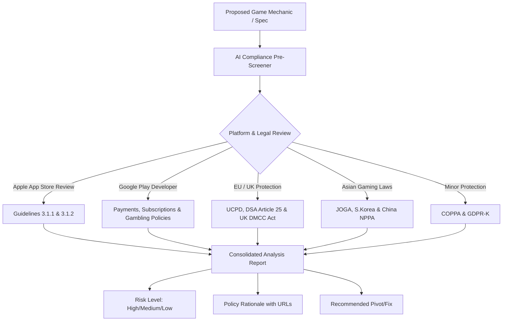

# ⚖️ Mobile Game Mechanic Compliance Pre-screener

> **Screen a proposed game mechanic against app store policies and consumer protection rules before you build it.**

---

## 🔍 Overview

The **Mobile Game Mechanic Compliance Pre-screener** is a system prompt ([`system_prompt.md`](./system_prompt.md)) for Game Producers, Monetization Designers, and Product Managers. It instructs an LLM to act as a **Strict Mobile Game Compliance Analyst** and review proposed features, gacha systems, subscriptions, and live-ops events against the platform policies and regulations in its reference library.

The output is a first-pass screen, not legal advice. Have a qualified lawyer review anything you plan to ship.

---

## ⚡ The Problem It Solves

A monetization mechanic or user flow that breaks platform or consumer protection rules can lead to:
*   ❌ **App Store or Google Play rejections** during live-ops campaigns.
*   📉 **Wasted development cycles** on features that must be redesigned.
*   ⚖️ **Regulatory enforcement** under EU, UK and US consumer protection law for deceptive design ("dark patterns").

The pre-screener gives each issue a risk level, the specific policy it touches, a rationale with the source URL, and a suggested pivot that keeps the business goal.

---

## 📚 Supported Regulations & Policies

The prompt's reference library cites these sources:

| Framework / Region | Covered Topics & Requirements | Key Reference Source |
| :--- | :--- | :--- |
| **Apple App Store** | Loot Box Odds (3.1.1), Non-expiring IAP Currency (3.1.1), Subscriptions (3.1.2) | [App Store Review Guidelines](https://developer.apple.com/app-store/review/guidelines/) |
| **Google Play** | Loot Box Odds Disclosure, Subscription Transparency & Cancellation, Real-Money Gambling | [Payments policy](https://support.google.com/googleplay/android-developer/answer/9858738), [Subscriptions policy](https://support.google.com/googleplay/android-developer/answer/9900533), [Real-Money Gambling policy](https://support.google.com/googleplay/android-developer/answer/9877032) |
| **European Union** | Dark Patterns, False Urgency, Deceptive Interface Design (DSA Article 25) | [EU UCPD 2005/29/EC](https://eur-lex.europa.eu/legal-content/EN/TXT/?uri=celex%3A32005L0029), [EU DSA (Regulation 2022/2065)](https://eur-lex.europa.eu/legal-content/EN/TXT/?uri=CELEX%3A32022R2065) |
| **United Kingdom** | Unfair Commercial Practices under the DMCC Act 2024 (misleading and aggressive practices) | [CMA guidance: Unfair commercial practices (CMA207)](https://www.gov.uk/government/publications/unfair-commercial-practices-cma207) |
| **United States** | Children's privacy and data collection (under 13) | [US COPPA Rule](https://www.ftc.gov/legal-library/browse/rules/childrens-online-privacy-protection-rule-coppa) |
| **EU (minors)** | Conditions for children's consent (GDPR Article 8) | [GDPR Article 8](https://gdpr-info.eu/art-8-gdpr/) |
| **Japan** | Complete Gacha (Kompu Gacha) ban, gacha odds disclosure | [JOGA Guidelines](https://japanonlinegame.org/joga_guideline/joga-guideline/) |
| **South Korea** | Mandatory disclosure of probability-based item rates (Article 33(2)) | [Game Industry Promotion Act (KLRI English translation)](https://elaw.klri.re.kr/eng_service/lawView.do?hseq=62498&lang=ENG) |
| **China** | Anti-addiction, minor spending/time caps, real-name checks | [NPPA](https://www.nppa.gov.cn/) |

Regulations change. The model only knows what is in the reference library plus its own training data, so check the linked source before acting on a finding.

---

## 🛠️ Setup

You can load this prompt into any chat LLM that accepts a system prompt or custom instructions. A current reasoning-capable model works best, for example any current Claude, GPT or Gemini model.

### Option 1: ChatGPT (Custom GPT)
1. Go to **GPTs** -> **Create**.
2. Open the **Configure** tab.
3. In **Instructions**, paste the entire contents of [`system_prompt.md`](./system_prompt.md).
4. Save it as a private or organization-wide GPT, for example **"Game Mechanic Compliance Auditor"**.

### Option 2: Claude
1. In Claude, create a new **Project**.
2. Paste the contents of [`system_prompt.md`](./system_prompt.md) into the project's **Instructions**.
3. Start a chat in the project and submit your design specs.

Without a Project, paste the prompt as your first message and the spec as your second.

### Option 3: Local LLMs (Ollama / LibreChat / Open WebUI)
1. Copy the contents of [`system_prompt.md`](./system_prompt.md).
2. Set it as the system prompt in LibreChat or Open WebUI, or as the `SYSTEM` instruction in an Ollama `Modelfile`.
3. Set a low temperature (for example `0.2` to `0.3`) to reduce variation between runs.

---

## 🚀 Quick Start / Try It Out

[`test_case_input.md`](./test_case_input.md) contains a sample monetization spec with deliberate problems you can use to test the prompt.

### How to Test:
1. Load [`system_prompt.md`](./system_prompt.md) into your chosen LLM as the system instruction.
2. Paste the contents of [`test_case_input.md`](./test_case_input.md) into the chat.
3. The spec is written to trigger findings in these areas:
   *   **Undisclosed gacha odds** (Apple Guideline 3.1.1 / Google Play Payments policy / South Korea Game Industry Promotion Act).
   *   **Subscription cancellation friction** (EU UCPD / Google Play Subscriptions policy / Apple Guideline 3.1.2).
   *   **Expiring paid currency and false urgency** (Apple Guideline 3.1.1 / EU UCPD / EU DSA Article 25).
   *   **Child-appealing design without age gates** (COPPA / GDPR-K).

---

## 📄 License

This repository is licensed under the [MIT License](LICENSE). Copyright (c) 2026 Rahul M Shah.
